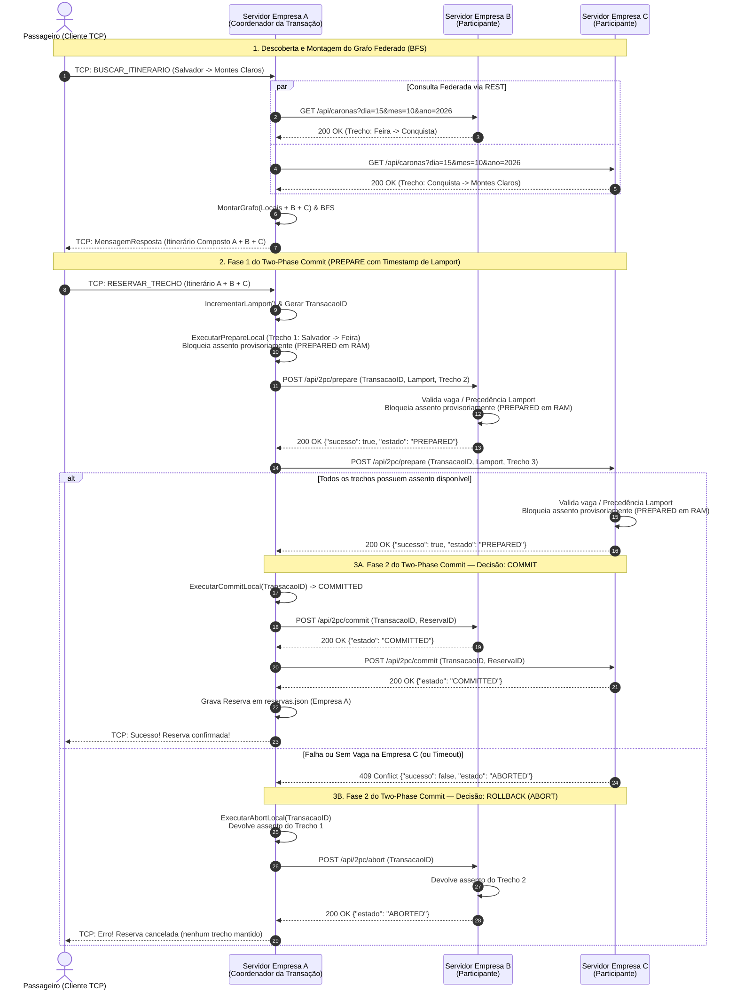

# Especificação da API REST do Consórcio — VaiJunto (Problema 2)

Este documento descreve o protocolo de comunicação distribuída baseado em **API REST (HTTP/JSON)** utilizado entre os servidores das empresas do consórcio **VaiJunto**.

Enquanto os clientes (motoristas e passageiros) continuam se comunicando exclusivamente com o servidor de sua própria empresa via **Sockets TCP**, os servidores das empresas cooperam de forma **100% descentralizada via requisições REST** (sem coordenador fixo, sem banco de dados compartilhado e mantendo apenas os três arquivos originais de cada empresa: `caronas.json`, `reservas.json` e `usuarios.json`) para:
1. **Monitoramento de saúde (Heartbeat)** e detecção de falhas por timeout;
2. **Descoberta federada de trechos disponíveis** para montagem do grafo de rotas;
3. **Confirmação atômica de itinerários inter-empresas via Two-Phase Commit (2PC)** com bloqueio temporário em memória e resolução determinística de conflitos baseada em **Relógio Lógico de Lamport**;
4. **Recuperação de falhas (Recovery)** e liberação automática de assentos bloqueados (*Presumed Abort*);
5. **Consulta de passageiros e propagação de cancelamentos** de reservas e de caronas entre empresas exclusivamente via requisições REST.

---

## 1. Visão Geral dos Recursos (Endpoints REST)

| Método | Recurso | Descrição | Códigos de Retorno |
|---|---|---|---|
| `GET` | `/api/heartbeat` | Verifica se o servidor parceiro está ativo e sincroniza o relógio lógico de Lamport | `200 OK` |
| `GET` | `/api/caronas` | Retorna os trechos ativos com assentos livres daquela empresa para uma data | `200 OK`, `500 Internal Server Error` |
| `GET` | `/api/caronas/passageiros` | Consulta no `reservas.json` do parceiro quais passageiros dele possuem reserva em uma carona | `200 OK` |
| `POST` | `/api/2pc/prepare` | **Fase 1 do 2PC (Votação)**: valida disponibilidade, aplica precedência de Lamport e bloqueia provisoriamente os assentos locais (`PREPARED`) | `200 OK`, `400 Bad Request`, `409 Conflict` |
| `POST` | `/api/2pc/commit` | **Fase 2 do 2PC (Confirmação)**: efetiva definitivamente a reserva dos assentos preparados (`COMMITTED`) | `200 OK`, `400 Bad Request`, `409 Conflict` |
| `POST` | `/api/2pc/abort` | **Fase 2 do 2PC (Rollback)**: cancela a pré-reserva e devolve imediatamente os assentos bloqueados (`ABORTED`) | `200 OK`, `400 Bad Request` |
| `GET` | `/api/2pc/status` | Consulta a decisão final de uma transação no servidor coordenador após recuperação de falha | `200 OK` |
| `POST` | `/api/reservas/liberar` | Devolve assentos locais quando um passageiro (ou outro trecho do itinerário) cancela uma reserva confirmada | `200 OK`, `400 Bad Request` |
| `POST` | `/api/caronas/cancelada` | Notifica os servidores parceiros que uma carona foi cancelada pelo motorista para remoção da reserva e liberação dos demais trechos | `200 OK`, `400 Bad Request` |

---

## 2. Detalhamento dos Endpoints

### 2.1 `GET /api/heartbeat`
Utilizado pela rotina periódica de *Batimento Cardíaco* (a cada `1.5s`, com timeout de `1.2s`) para verificar se os servidores parceiros estão operacionais e atualizar o Relógio Lógico de Lamport.

* **Resposta (`200 OK`)**:
```json
{
  "status": "ONLINE",
  "empresa_id": "empresaA",
  "url": "http://localhost:9081",
  "lamport": 42
}
```

---

### 2.2 `GET /api/caronas?dia=DD&mes=MM&ano=AAAA`
Retorna apenas as arestas de trechos ativos e com assentos disponíveis (`assentos_livres > 0`) pertencentes àquela empresa na data solicitada, sem expor dados sensíveis de usuários.

* **Parâmetros de Query**: `dia`, `mes`, `ano` (inteiros).
* **Resposta (`200 OK`)**:
```json
[
  {
    "carona_id": "CAR-1793241197280544300",
    "motorista_id": "thay",
    "empresa_id": "empresaA",
    "servidor_url": "http://localhost:9081",
    "origem": "Salvador",
    "destino": "Feira de Santana",
    "horario_partida": "2026-10-15T08:00:00-03:00",
    "horario_chegada": "2026-10-15T09:30:00-03:00",
    "preco": 25.0,
    "assentos_livres": 2
  }
]
```

---

### 2.3 `GET /api/caronas/passageiros?carona_id=CAR-...&servidor_url=http://...`
Quando um motorista consulta os passageiros da sua carona (ou vai cancelá-la), o servidor dele consulta via REST todos os servidores parceiros do consórcio. Cada parceiro verifica seu próprio `reservas.json` e retorna os e-mails dos passageiros que possuem reserva ativa naquela carona.

* **Resposta (`200 OK`)**:
```json
[
  "maria@email.com",
  "joao@email.com"
]
```

---

### 2.4 `POST /api/2pc/prepare` (Fase 1 do Two-Phase Commit)
Solicita o bloqueio temporário dos assentos dos trechos sob responsabilidade do servidor participante.

* **Critério de Precedência na Disputa pelo Último Assento**:
  Cada transação recebe no seu início a tupla de prioridade `(timestamp_lamport, empresa_origem_id, transacao_id)`. Caso dois passageiros de empresas distintas disputem simultaneamente o último assento de um trecho durante a fase `PREPARED`, o servidor detentor da carona compara as tuplas em memória: se a nova requisição tiver **maior precedência** (menor valor de `timestamp_lamport`, desempatando lexicograficamente por `empresa_origem_id` e `transacao_id`), ela **preempciona (aborta)** a transação `PREPARED` concorrente e assume o assento.

* **Requisição**:
```json
{
  "transacao_id": "TX-empresaA-1793241407138189400",
  "reserva_id": "RES-1793241407138189400",
  "passageiro_id": "maria@email.com",
  "empresa_origem_id": "empresaA",
  "coordenador_url": "http://localhost:9081",
  "timestamp_lamport": 105,
  "trechos_locais": [
    {
      "carona_id": "CAR-1793241282878820200",
      "origem": "Feira de Santana",
      "destino": "Vitória da Conquista"
    }
  ]
}
```

* **Resposta — Sucesso / Voto Favorável (`200 OK`)**:
```json
{
  "sucesso": true,
  "estado": "PREPARED",
  "mensagem": "Assentos pré-reservados (PREPARED).",
  "lamport": 106
}
```

* **Resposta — Falha / Sem Assento Disponível (`409 Conflict`)**:
```json
{
  "sucesso": false,
  "estado": "ABORTED",
  "mensagem": "o trecho de Feira de Santana para Vitória da Conquista não possui mais assentos disponíveis",
  "lamport": 106
}
```

---

### 2.5 `POST /api/2pc/commit` (Fase 2 — Confirmação)
Enviado pelo servidor coordenador da compra após **todos** os servidores envolvidos no itinerário responderem `200 OK (PREPARED)`. Confirma definitivamente a reserva dos assentos preparados.

* **Requisição**:
```json
{
  "transacao_id": "TX-empresaA-1793241407138189400",
  "reserva_id": "RES-1793241407138189400",
  "lamport": 108
}
```

* **Resposta (`200 OK`)**:
```json
{
  "sucesso": true,
  "estado": "COMMITTED",
  "mensagem": "Transação confirmada (COMMITTED).",
  "lamport": 109
}
```

---

### 2.6 `POST /api/2pc/abort` (Fase 2 — Rollback)
Enviado pelo servidor coordenador caso **qualquer** servidor participante vote `ABORTED` (409) ou sofra falha/timeout na Fase 1. Devolve imediatamente os assentos locais pré-reservados.

* **Requisição**:
```json
{
  "transacao_id": "TX-empresaA-1793241407138189400",
  "reserva_id": "RES-1793241407138189400",
  "lamport": 108
}
```

* **Resposta (`200 OK`)**:
```json
{
  "sucesso": true,
  "estado": "ABORTED",
  "mensagem": "Transação abortada e assentos devolvidos.",
  "lamport": 109
}
```

---

### 2.7 `GET /api/2pc/status?transacao_id=TX-...&reserva_id=RES-...`
Usado na recuperação de falhas (*Recovery*). Quando um servidor participante possui uma transação em estado `PREPARED` cujo timeout expirou, ele consulta o `coordenador_url` via REST para verificar se a reserva foi confirmada no `reservas.json` do coordenador (`COMMITTED`) ou não (`ABORTED` — *Presumed Abort*).

---

### 2.8 `POST /api/reservas/liberar`
Chamado via REST quando um passageiro cancela sua reserva confirmada (ou quando uma reserva composta é desfeita devido ao cancelamento de outro motorista), instruindo o servidor detentor do trecho a incrementar `AssentosLivre++` no seu `caronas.json`.

---

### 2.9 `POST /api/caronas/cancelada`
Chamado via REST quando um motorista cancela sua carona. O servidor do motorista envia esta notificação para os servidores parceiros do consórcio (e também reenvia automaticamente quando um servidor parceiro volta de `OFFLINE` para `ONLINE` no Heartbeat). Cada parceiro varre seu `reservas.json`, apaga eventuais reservas que utilizavam aquela carona e aciona `/api/reservas/liberar` nos demais servidores que compunham aquele itinerário.

---

## 3. Diagrama de Sequência — Confirmação de Itinerário Inter-Empresas (2PC)


