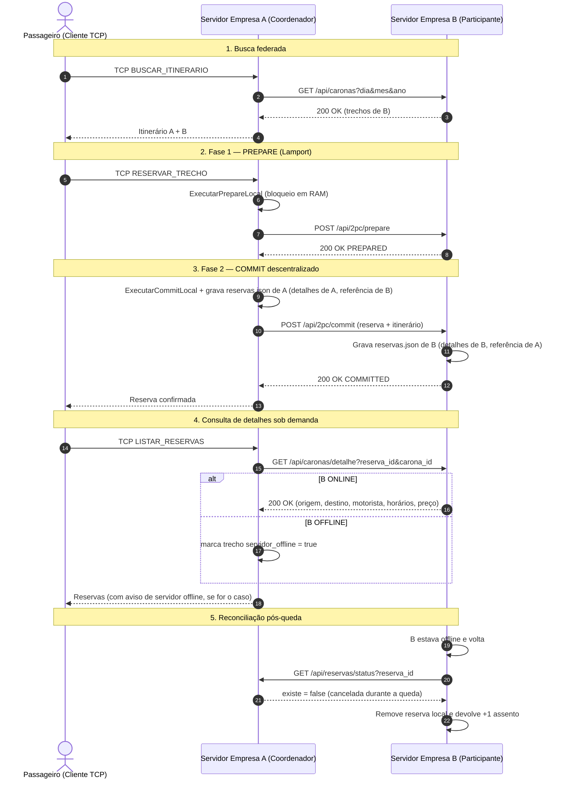

# Especificação da API REST do Consórcio — VaiJunto (Problema 2)

Este documento descreve o protocolo de comunicação distribuída baseado em **API REST (HTTP/JSON)** utilizado entre os servidores das empresas do consórcio **VaiJunto**.

Enquanto os clientes (motoristas e passageiros) continuam se comunicando exclusivamente com o servidor de sua própria empresa via **Sockets TCP**, os servidores das empresas cooperam de forma **100% descentralizada via requisições REST** (sem coordenador fixo, sem banco de dados compartilhado e mantendo apenas os três arquivos originais de cada empresa: `caronas.json`, `reservas.json` e `usuarios.json`) para:
1. **Monitoramento de saúde (Heartbeat)** e detecção de falhas por timeout;
2. **Descoberta federada de trechos disponíveis** para montagem do grafo de rotas;
3. **Confirmação atômica de itinerários inter-empresas via Two-Phase Commit (2PC)** com armazenamento descentralizado nos arquivos `reservas.json` de cada servidor participante (cada servidor armazena os detalhes completos apenas dos seus próprios trechos e somente a referência `carona_id` + `servidor_url` para os demais servidores participantes);
4. **Consulta sob demanda de detalhes de trechos remotos (`GET /api/caronas/detalhe`)**, exibindo os dados em tempo real quando o servidor parceiro está `ONLINE` ou informando ao usuário quando está `OFFLINE`;
5. **Reconciliação automática pós-queda (`GET /api/reservas/status`)**, garantindo que quando um servidor derrubado retorna, ele detecta reservas canceladas enquanto estava fora do ar, remove-as localmente e restaura `+1` assento (`AssentosLivre++`) imediatamente;
6. **Consulta de passageiros e propagação de cancelamentos** de reservas e de caronas entre empresas exclusivamente via requisições REST.

---

## 1. Visão Geral dos Recursos (Endpoints REST)

| Método | Recurso | Descrição | Códigos de Retorno |
|---|---|---|---|
| `GET` | `/api/heartbeat` | Verifica se o servidor parceiro está ativo e sincroniza o relógio lógico de Lamport | `200 OK` |
| `GET` | `/api/caronas` | Retorna os trechos ativos com assentos livres daquela empresa para uma data | `200 OK`, `500 Internal Server Error` |
| `GET` | `/api/caronas/detalhe` | Retorna sob demanda os detalhes atualizados (motorista, horários, preço) de uma corrida local | `200 OK`, `404 Not Found` |
| `GET` | `/api/caronas/passageiros` | Consulta no `reservas.json` do parceiro quais passageiros dele possuem reserva em uma carona | `200 OK` |
| `POST` | `/api/2pc/prepare` | **Fase 1 do 2PC (Votação)**: valida disponibilidade, aplica precedência de Lamport e bloqueia provisoriamente os assentos locais (`PREPARED`) | `200 OK`, `400 Bad Request`, `409 Conflict` |
| `POST` | `/api/2pc/commit` | **Fase 2 do 2PC (Confirmação)**: efetiva definitivamente a reserva e grava a cópia descentralizada no `reservas.json` do participante (`COMMITTED`) | `200 OK`, `400 Bad Request`, `409 Conflict` |
| `POST` | `/api/2pc/abort` | **Fase 2 do 2PC (Rollback)**: cancela a pré-reserva e devolve imediatamente os assentos bloqueados (`ABORTED`) | `200 OK`, `400 Bad Request` |
| `GET` | `/api/2pc/status` | Consulta a decisão final de uma transação no servidor coordenador após recuperação de falha | `200 OK` |
| `GET` | `/api/reservas/status` | Informa se uma reserva ainda está ativa neste servidor (usado na reconciliação pós-queda para restaurar `+1` assento) | `200 OK` |
| `POST` | `/api/reservas/liberar` | Remove a reserva local e devolve `+1` assento quando uma reserva confirmada é cancelada | `200 OK`, `400 Bad Request` |
| `POST` | `/api/caronas/cancelada` | Notifica os servidores parceiros que uma carona foi cancelada pelo motorista para remoção da reserva e liberação dos demais trechos | `200 OK`, `400 Bad Request` |

---

## 2. Detalhamento dos Endpoints

### 2.1 `GET /api/heartbeat`
Utilizado pela rotina periódica de *Batimento Cardíaco* (a cada `1.5s`, com timeout de `1.5s`) para verificar se os servidores parceiros estão operacionais e atualizar o Relógio Lógico de Lamport.

* **Resposta (`200 OK`)**:
```json
{
  "status": "ONLINE",
  "empresa_id": "empresaA",
  "url": "http://localhost:9081",
  "lamport": 42
}
```

---

### 2.2 `GET /api/caronas?dia=DD&mes=MM&ano=AAAA`
Retorna apenas as arestas de trechos ativos e com assentos disponíveis (`assentos_livres > 0`) pertencentes àquela empresa na data solicitada, sem expor dados sensíveis de usuários.

* **Parâmetros de Query**: `dia`, `mes`, `ano` (inteiros).
* **Resposta (`200 OK`)**:
```json
[
  {
    "carona_id": "CAR-1793241197280544300",
    "motorista_id": "thay",
    "empresa_id": "empresaA",
    "servidor_url": "http://localhost:9081",
    "origem": "Salvador",
    "destino": "Feira de Santana",
    "horario_partida": "2026-10-15T08:00:00-03:00",
    "horario_chegada": "2026-10-15T09:30:00-03:00",
    "preco": 25.0,
    "assentos_livres": 2
  }
]
```

---

### 2.3 `GET /api/caronas/detalhe?reserva_id=RES-...&carona_id=CAR-...`
Como o `reservas.json` é descentralizado (o servidor `A` guarda apenas os detalhes de `A` e, para o trecho de `B`, somente `carona_id`, `empresa_id` e `servidor_url` — sem origem/destino, já que o ID da carona é único), sempre que o passageiro solicita a visualização de suas reservas, o servidor envia apenas **`reserva_id` + `carona_id`** ao servidor dono do trecho. Este localiza o trecho na sua própria cópia da reserva/carona e devolve todos os dados.
* Se o servidor participante estiver **ONLINE**, retorna `200 OK` com `origem`, `destino`, `motorista_id`, `horario_partida`, `horario_chegada` e `preco`.
* Se estiver **OFFLINE**, o trecho é marcado com `servidor_offline: true` e o cliente exibe `[SERVIDOR OFFLINE - Detalhes indisponíveis no momento]`.

* **Exemplo — referência guardada no `reservas.json` da Empresa A para o trecho da Empresa B**:
```json
{ "carona_id": "CAR-B-7", "empresa_id": "empresaB", "servidor_url": "http://192.168.1.11:9082" }
```

* **Resposta (`200 OK`)**:
```json
{
  "carona_id": "CAR-B-7",
  "motorista_id": "joao@email.com",
  "empresa_id": "empresaB",
  "servidor_url": "http://192.168.1.11:9082",
  "origem": "Feira de Santana",
  "destino": "Montes Claros",
  "horario_partida": "2026-11-25T11:00:00-03:00",
  "horario_chegada": "2026-11-25T16:00:00-03:00",
  "preco": 110
}
```

---

### 2.4 `GET /api/caronas/passageiros?carona_id=CAR-...&servidor_url=http://...`
Quando um motorista consulta os passageiros da sua carona (ou vai cancelá-la), o servidor dele consulta via REST os servidores parceiros do consórcio.

* **Resposta (`200 OK`)**:
```json
[
  "maria@email.com",
  "joao@email.com"
]
```

---

### 2.5 `POST /api/2pc/prepare` (Fase 1 do Two-Phase Commit)
Solicita o bloqueio temporário dos assentos dos trechos sob responsabilidade do servidor participante.

* **Critério de Precedência na Disputa pelo Último Assento**:
  Cada transação recebe no seu início a tupla de prioridade `(timestamp_lamport, empresa_origem_id, transacao_id)`. Caso dois passageiros de empresas distintas disputem simultaneamente o último assento de um trecho durante a fase `PREPARED`, o servidor detentor da carona compara as tuplas em memória: se a nova requisição tiver **maior precedência** (menor valor de `timestamp_lamport`, desempatando lexicograficamente por `empresa_origem_id` e `transacao_id`), ela **preempciona (aborta)** a transação `PREPARED` concorrente e assume o assento.

---

### 2.6 `POST /api/2pc/commit` (Fase 2 — Confirmação Descentralizada)
Enviado pelo servidor coordenador da compra após **todos** os servidores envolvidos no itinerário responderem `200 OK (PREPARED)`. Confirma definitivamente a reserva dos assentos preparados e salva a reserva de forma descentralizada no `reservas.json` de cada servidor participante (detalhes completos para os trechos daquele próprio servidor e apenas referência de `carona_id` e `servidor_url` para os trechos dos outros servidores).

---

### 2.7 `POST /api/2pc/abort` (Fase 2 — Rollback)
Enviado pelo servidor coordenador caso **qualquer** servidor participante vote `ABORTED` (409) ou sofra falha/timeout na Fase 1. Devolve imediatamente os assentos locais pré-reservados.

---

### 2.8 `GET /api/2pc/status?transacao_id=TX-...&reserva_id=RES-...`
Usado na recuperação de falhas (*Recovery*) durante a votação do 2PC.

---

### 2.9 `GET /api/reservas/status?reserva_id=RES-...`
Usado na **reconciliação pós-queda (`sincronizarReservasComPeers`)**. Quando um servidor participante volta a ficar online (ou periodicamente no Heartbeat / antes de consultas), ele verifica junto aos outros servidores participantes de cada reserva local se aquela reserva ainda existe (`{"existe": true}`) ou se foi cancelada enquanto ele estava desligado (`{"existe": false}`). Caso tenha sido cancelada durante sua ausência, ele apaga imediatamente a reserva do seu `reservas.json` e restaura `+1` assento (`AssentosLivre++`) no seu `caronas.json`.

---

### 2.10 `POST /api/reservas/liberar` e `POST /api/caronas/cancelada`
Chamados via REST quando um passageiro cancela sua reserva confirmada ou quando um motorista cancela sua carona, removendo a reserva do `reservas.json` e devolvendo `+1` assento (`AssentosLivre++`) no `caronas.json` de cada servidor participante de forma idempotente.

---

## 3. Diagrama de Sequência — Reserva Inter-Empresas (2PC Descentralizado)


